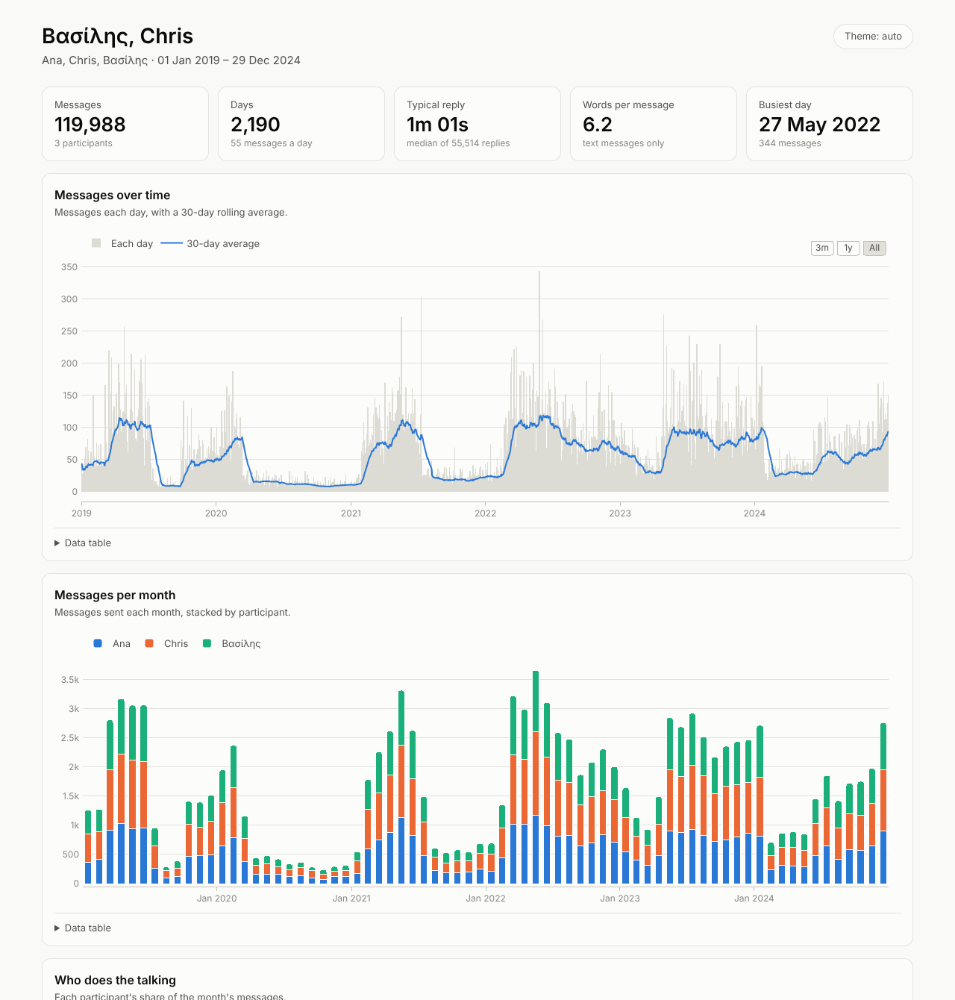

<p align="center">
  
</p>

# Nostos

*νόστος (Greek): homecoming, the root of "nostalgia".*

Nostos turns your chat history into statistics and interactive charts, so you can
look back on your conversations: who talks most, when you talk, how fast you
reply, how it all changed over the years.

It runs entirely on your computer. Your messages are never uploaded anywhere.



**Supported today:** Facebook Messenger (JSON export). Instagram and WhatsApp are planned.

## Quick start

Requires Python 3.10 or newer.

```bash
git clone https://github.com/kordoulakis/MessengerAnalyzer.git nostos
cd nostos
python -m venv .venv
source .venv/bin/activate          # Windows: .venv\Scripts\activate
pip install -e ".[charts]"
nostos dashboard example           # opens a dashboard of the bundled sample chat
```

Then [download your own chats](#get-your-chats) and run `nostos dashboard <name>`.

## Get your chats

1. On Facebook, open **Download your information**: <https://www.facebook.com/dyi>
   (or Settings → Accounts Center → Your information and permissions → Download your
   information). Facebook moves these menus around from time to time.
2. Choose **Messages** only, format **JSON** (not HTML), date range **All time**, and
   request the download. Facebook emails you when it's ready.
3. Unzip it and find the `inbox` folder (usually `your_facebook_activity/messages/inbox/`,
   or `messages/inbox/` in older exports). It has one folder per conversation, named
   like `alexsmith_123456789`, each containing `message_1.json`, `message_2.json`, ...
4. Copy the conversations you want into the `MessagesSources/` folder of this project
   and rename them to something short, e.g. `MessagesSources/alex/`.

`MessagesSources/` is ignored by git, so your chats are never committed by accident.
`nostos list` shows what it finds there.

> Chats that use end-to-end encryption (the default for new Messenger chats since
> late 2023) may be missing from this export or contain only older messages.

## Usage

```bash
nostos list                              # conversations in MessagesSources/
nostos dashboard alex                    # all charts and headline numbers on one page
nostos report alex                       # every statistic as text
nostos report alex --format json -o alex.json
nostos charts                            # list the available charts
nostos plot alex monthly --by-participant
nostos plot alex activity --keywords "coffee,beer"
nostos plot alex rhythm -o rhythm.png    # static image instead of an interactive page
```

`alex` is the name of a folder inside `MessagesSources/`. You can also pass any path
to a conversation folder, e.g. `nostos dashboard ~/Downloads/inbox/alexsmith_123456789`.

**Where output goes:**

| Command | Writes | Then |
|---|---|---|
| `nostos dashboard alex` | `alex-dashboard.html` in the current folder | opens it in your browser |
| `nostos plot alex monthly` | `alex-monthly.html` in the current folder | opens it in your browser |
| `nostos report alex` | nothing; prints to the terminal | |
| any of them with `-o FILE` | `FILE` | doesn't open a browser (add `--open` to) |

For `plot`, an `-o` ending in `.png`, `.svg` or `.pdf` saves a static image instead.
That needs the export extra: `pip install -e ".[export]"`.

The HTML pages are single, self-contained files: open them by double-clicking, no
server needed. They follow your system's light or dark mode and have a toggle in the
top-right corner. Hover over any chart for exact values, drag to zoom, double-click
to reset, and open **Data table** under a chart to see its numbers.

### Charts

| Name | Shows |
|---|---|
| `activity` | Messages per day with a rolling average |
| `monthly` | Messages per month; `--by-participant` stacks them by person |
| `share` | Each person's share of the conversation, month by month |
| `rhythm` | Heatmap of when you talk: weekday × hour |
| `participants` | Total messages per person |
| `response-times` | How fast people reply: share of replies under 1 min, 1–5 min, ... |
| `response-trend` | Median reply time, month by month |
| `words` | Average words per message, month by month |
| `kinds` | Message types: text, photos, videos, voice notes, calls, stickers, ... |
| `top-words` | Most used words |

### Options

| Option | Meaning |
|---|---|
| `--by-participant` | One line or bar per person (up to 8; quieter people are grouped as "Other") |
| `--keywords a,b` | `report`: count these words. `plot activity`: only messages containing them |
| `--max-gap 6h` | Ignore replies that come after a long silence; those are usually a new conversation, not a reply |
| `--tz Europe/Athens` | Timezone for dates and hours (default: your computer's) |
| `--window 7` | Days in the `activity` rolling average (default: 30) |
| `--unit hours` | Unit for reply times in charts: `seconds`, `minutes` (default) or `hours` |
| `--top 50` | Number of words in `top-words` (default: 20) |
| `--theme dark` | Force a theme: `auto` (default, follows the system), `light` or `dark` |
| `--cdn` | Load the charting library from the internet: the page is ~4.7 MB smaller but needs a connection to view |
| `-v` | Show how long loading and analysis took |

`nostos <command> --help` lists every option.

## Privacy

- Nostos reads your export from disk and writes results to disk. It makes no network requests.
- Dashboards and charts embed everything they need, so they open offline. The one
  exception is `--cdn`, which makes the page download the charting library
  (not your data) from cdn.plot.ly when opened.
- Generated pages and reports contain names, word lists and activity patterns.
  Treat them as private as the chat itself before sharing them.

## Troubleshooting

**"No chat export found" or "is not a folder"**: point Nostos at a single
conversation folder, the one that contains `message_1.json`. Not the zip and not the
`inbox` folder. If the folder has `message_1.html` instead, the export was made in
HTML format: request it again as JSON.

**Hours or days look shifted**: pass your timezone, e.g. `--tz Europe/Athens`.

**Image export fails**: install the export extra (`pip install -e ".[export]"`) and
run `plotly_get_chrome` once so it can find a browser to render with.

**`nostos` runs a different program**: an unrelated PyPI package (a git tool) is also
called `nostos`. Use a separate virtual environment, or run `python -m nostos`.

**Garbled characters like `é` or `Γ`**: Facebook's export mangles every non-English
character, and Nostos repairs this automatically for every language and for emoji.
If you still see garbled text, please open an issue.

## Use it from Python

```python
from pathlib import Path

from nostos import analysis as an
from nostos import loaders

conv = loaders.load(Path("MessagesSources/alex")).in_timezone("Europe/Athens")
print(an.messages_per_sender(conv.messages))
print(an.messages_per_period(conv.messages, "month", by_sender=True))
print(an.top_words(conv.messages, 20))
```

Every analysis function takes the messages table and returns a
[Polars](https://pola.rs) DataFrame or a number.

## Development

```bash
pip install -e . --group dev     # needs pip 25.1 or newer
pytest                           # tests
ruff check . && ruff format .    # lint and format
mypy                             # type-check
```

[docs/ARCHITECTURE.md](docs/ARCHITECTURE.md) explains how the code is organised, how
to add a new chat platform, and performance numbers. `benchmarks/generate_sample.py`
creates realistic fake chats of any size for testing.

## Roadmap

- Instagram and WhatsApp exports
- A web app

## License

MIT. See [LICENSE](LICENSE).
